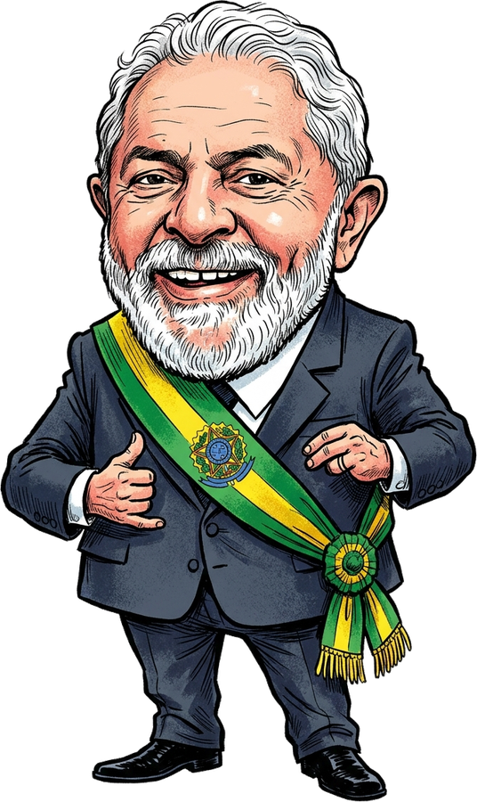

# 🇧🇷 Desktop Lula: Edição Presidencial

<p align="center">
  
</p>

<p align="center">
  <strong>O pet virtual satírico mais carismático para a sua área de trabalho no Windows!</strong><br>
  Desenvolvido em Python e PyQt6 com física realista, 60 FPS e charges editoriais no clássico estilo de cartum de jornal.
</p>

<p align="center">
  
  
  
  
</p>

---

## 🎭 Sobre o Projeto

O **Desktop Lula** é um aplicativo de entretenimento satírico e paródia da cultura da internet brasileira. Ele caminha sobre suas janelas abertas, faz caretas expressivas, interage com o cursor do mouse e recebe visitas épicas de outras figuras caricatas do cenário nacional.

> ⚖️ **Aviso Legal & Paródia:** Este software é uma obra artística e cômica de ficção e sátira política, sem qualquer vínculo oficial, partidário ou governamental. O projeto é amparado pelo **Art. 5º, incisos IV e IX da Constituição Federal de 1988**, pelo **Art. 47 da Lei nº 9.610/1998 (Direito de Paródia)** e pela jurisprudência vinculante do **STF (ADI 4451)**. O software não é vírus/malware, não coleta dados e não acessa a internet.

---

## ✨ Recursos & Eventos Hilários

- 🥷 **Furto Solidário de Cursor:** Periodicamente, o companheiro se aproxima na ponta dos pés, pega seu mouse por ~2 segundos, esconde no paletó e devolve com um sorriso inocente.
- ⚖️ **Xandão & Prisão Preventiva:** O Ministro do STF surge de toga com sua careca reluzente, bate o martelo judicial na tela e decreta a prisão cautelar do cursor!
- 🚩 **Reforma Agrária no Desktop:** Deixou o computador ocioso por mais de 30 segundos? O MST ocupa a tela argumentando improdutividade e monta acampamento com barracas e panelaço!
- 🚨 **Viatura da Polícia Federal:** Moro e Dallagnol chegam em alta velocidade com giroflex e apresentação em PowerPoint para dispersar os manifestantes.
- ✈️ **Janja Tour (Aerolula VIP):** O jato oficial da FAB cruza o monitor puxando a faixa: *"🛍️ JANJA TOUR: PARTIU COMPRAS!"*.
- 👉 **Bolsonaro na Barra de Tarefas:** O Capitão surge fazendo a arminha e alertando que qualquer lentidão do Windows é culpa da herança maldita.
- 📢 **Protesto Gourmet da PUC:** Estudantes marcham com beret do Che Guevara, panela Le Creuset e copo Stanley.

---

## 🚀 Como Executar o Código-Fonte Localmente

### Pré-requisitos
- Python 3.10 ou 3.11 instalado no Windows.
- Git instalado.

### 1. Clonar o repositório
```bash
git clone https://github.com/SEU-USUARIO/desktop-lula.git
cd desktop-lula
```

### 2. Instalar dependências
```bash
pip install PyQt6 Pillow psutil
```

### 3. Rodar o aplicativo
```bash
python main.py
```

O aplicativo iniciará com ícone na bandeja do sistema (perto do relógio). Clique com o botão direito para acessar o menu completo!

---

## 🔨 Como Compilar o Executável (.exe)

O projeto pode ser empacotado em um único arquivo `.exe` sem console usando o PyInstaller:

```bash
pip install pyinstaller
python -m PyInstaller DesktopLula.spec
```

O executável independente estará disponível em `dist/DesktopLula.exe`.

---

## 🌐 Landing Page Oficial

A pasta `landing_page/` contém o website completo, com simulador web interativo no navegador, soundboard de efeitos e formulário de download com apoio via PIX.

---

## 📜 Licença e Propriedade Intelectual

Consulte o arquivo [LICENSE](LICENSE) para termos completos de uso.
- O código-fonte é aberto para visualização, estudo e auditoria técnica de segurança.
- As ilustrações, charges editoriais e sprites são obras autorais protegidas pela Lei Federal nº 9.610/1998. É expressamente vedada a comercialização, plágio ou redistribuição sob outro nome sem autorização dos autores.
